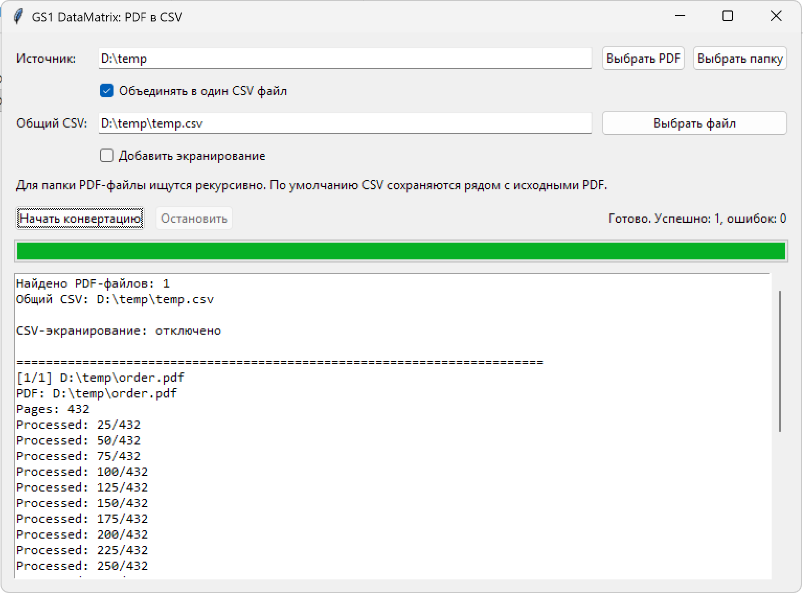

# DMTools

Автономное GUI-приложение для извлечения кодов GS1 DataMatrix «Честный знак» из PDF в CSV и генерации этикеток.

## Предупреждение

Приложение создано с использованием AI-assisted разработки, с последующим ручным разбором кода и тестированием.



## Возможности

- выбор одного PDF-файла или папки;
- рекурсивный поиск PDF в выбранной папке;
- сохранение CSV рядом с исходным PDF по умолчанию;
- объединение результатов всех PDF в один CSV по отдельному флажку;
- имя общего файла по умолчанию совпадает с именем выбранной папки;
- автоматическое заполнение пути общего CSV при включении объединения;
- буквальная запись кодов без CSV-экранирования по умолчанию;
- стандартное CSV-экранирование после установки флажка «Добавить экранирование»;
- отдельный выходной CSV для каждого PDF, если объединение отключено;
- одна колонка `code` с исходным кодом и разделителями GS (ASCII 29);
- проверка FNC1/GS1, AI 01/21/91/92 и контрольной цифры GTIN;
- автоматические суффиксы `_2`, `_3` для одинаковых имён PDF;
- подтверждение перед перезаписью существующего общего CSV;
- журнал и прогресс обработки в окне;
- остановка пакетной обработки.

## Запуск из Python

```powershell
python -m pip install -r requirements.txt
python main.py
```

## Сборка автономного EXE

```powershell
powershell -ExecutionPolicy Bypass -File .\build_exe.ps1
```

Готовый файл появится здесь:

```text
dist\DMTools.exe
```

На компьютере пользователя Python и библиотеки не требуются.

## Формат CSV

CSV записывается в UTF-8 с BOM и содержит заголовок `code`. По умолчанию значения записываются буквально, без внешних кавычек и удвоения внутренних кавычек. При установленном флажке «Добавить экранирование» применяется стандартное CSV-экранирование. Управляющие символы GS сохраняются без замены.

## Лицензия

Проект распространяется под лицензией GNU AGPL v3.0. Полный текст лицензии находится в файле [LICENSE](LICENSE).

Основные используемые библиотеки:

- PyMuPDF / MuPDF — GNU AGPL v3.0 или коммерческая лицензия Artifex.
- zxing-cpp — Apache License 2.0.
- Pillow — MIT-CMU License.

Подробности по сторонним зависимостям см. в [THIRD_PARTY_LICENSES.md](THIRD_PARTY_LICENSES.md).

При распространении собранного EXE необходимо соблюдать условия лицензий используемых библиотек и сохранять доступ к соответствующему исходному коду.
